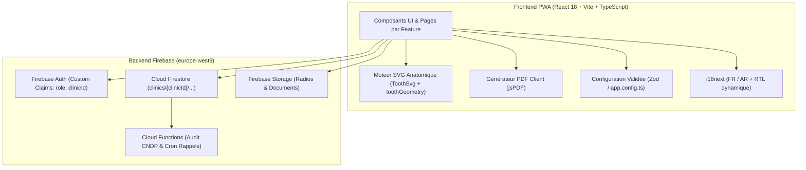

# Architecture Technique & Guide d'Intégration (ARCHITECTURE.md)

Ce document présente l'architecture interne de **DentaMaroc** afin de permettre aux développeurs tiers, intégrateurs et cabinets dentaires d'étendre ou de personnaliser facilement la plateforme.

---

## 1. Vue d'Ensemble de l'Architecture



---

## 2. Système de Configuration & White-Labeling (`src/config/app.config.ts`)

Pour faciliter la réutilisation open-source par des tiers (cabinets au Maroc, au Maghreb, en Afrique francophone ou en Europe), aucune constante régionale n'est figée en dur dans la logique métier :

- [`src/config/app.config.ts`](../src/config/app.config.ts) valide les variables `import.meta.env` à l'aide d'un schéma **Zod**.
- Les utilitaires [`src/lib/formatters.ts`](../src/lib/formatters.ts) (`formatCurrency`, `formatPhoneNumber`, `getWhatsAppReminderLink`) et [`src/config/firebase.ts`](../src/config/firebase.ts) lisent automatiquement `appConfig`.
- La fonction pure `parseAppConfig(rawEnv)` permet de tester unitairement n'importe quelle configuration pays (voir [`tests/unit/appConfig.test.ts`](../tests/unit/appConfig.test.ts)).

---

## 3. Architecture de l'Odontogramme SVG (`src/features/odontogram/`)

L'odontogramme est découpé en 3 couches découplées et réutilisables indépendamment :

1. **`toothGeometry.ts` (Logique géométrique pure, zéro dépendance React)** :
   - Associe chaque numéro **FDI** (adulte `11–48`, enfant `51–85`) à un type morphologique (`central`, `lateral`, `canine`, `premolar`, `premolarTwoRoots`, `molarUpper`, `molarLower`).
   - Définit les tracés SVG (`crown`, `root`, `canals`, `occlusal.outline`, `occlusal.fissures`) dans un repère normalisé.
   - Calcule automatiquement l'orientation **Mésiale / Distale** selon le quadrant du patient (les quadrants droits `1, 4, 5, 8` ont leur face mésiale à droite de l'écran ; les quadrants gauches `2, 3, 6, 7` ont leur face mésiale à gauche).

2. **`ToothSvg.tsx` (Composant de rendu vectoriel pur)** :
   - `OdontogramDefs` : Dégradés SVG partagés (`#dm-enamel`, `#dm-root`, `#dm-gold`, `#dm-ceramic`, `#dm-titanium`, `#dm-gum`).
   - `VestibularView` : Vue de face avec bande gingivale, racines anatomiques, canaux radiculaires, vis d'implant en titane, couronne prothétique et marqueurs de caries/obturations.
   - `OcclusalView` : Vue occlusale découpée en 5 polygones cliquables (`data-surface="occlusal|mesial|distal|vestibular|lingual"`) écrêtés (`clipPath`) par le contour anatomique de la dent.

3. **`OdontogramView.tsx` (Orchestrateur clinique)** :
   - Gère l'état du schéma dentaire, la sélection rapide par clic direct sur une face, le choix du matériau (`composite`, `amalgam`, `ceramic`, `metal`) et l'aperçu zoomé en direct avant enregistrement.

> **Réutiliser `<ToothSvg />` ailleurs dans l'application** (ex: dans un devis ou une fiche de suivi) :
> ```tsx
> import { OdontogramDefs, ToothSvg } from '@/features/odontogram/ToothSvg';
>
> <OdontogramDefs />
> <ToothSvg
>   toothNumber={26}
>   condition={{ state: 'crown', material: 'ceramic' }}
>   scale={1.5}
> />
> ```

---

## 4. Modèle Multi-Tenant Firestore & Sécurité

Toutes les données d'un cabinet résident sous `clinics/{clinicId}/...` :

```
clinics/{clinicId}
 ├── users/{userId}
 ├── patients/{patientId}
 ├── appointments/{appointmentId}
 ├── toothCharts/{chartId}
 ├── treatmentPlans/{planId}
 ├── procedures/{procedureId}
 ├── invoices/{invoiceId}
 ├── payments/{paymentId}
 ├── expenses/{expenseId}
 ├── cashClosings/{closingId}
 ├── documents/{documentId}
 └── auditLogs/{logId}
```

### Pourquoi des sous-collections par cabinet ?
- **Sécurité par construction** : Une règle parente `isMemberOf(clinicId)` dans [`firestore.rules`](../firestore.rules) empêche toute lecture croisée entre cabinets.
- **Performance & Coûts Firestore** : Les index et les requêtes sont partitionnés par `clinicId`. Les champs fréquemment affichés (`patientName`, `patientPhone`, `dentistName`) sont dénormalisés dans `appointments`, `invoices` et `payments` afin d'éviter les lectures multiples ($N+1$ reads) lors de l'affichage de l'agenda ou de la caisse.
